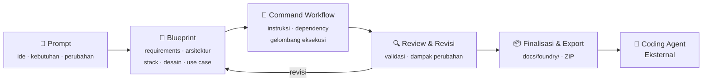

<div align="center">

[English](README.md) | **Bahasa Indonesia**

# ⚒️ Foundry

### Universal Software Blueprint & Command Workflow Designer

**Ubah ide menjadi blueprint terstruktur dan command workflow yang siap dikerjakan coding agent.**

[](https://github.com/handrawanwdev/Foundry/actions/workflows/ci.yml)
[](https://github.com/handrawanwdev/Foundry/releases)
[](https://go.dev)
[](https://react.dev)
[](https://www.typescriptlang.org)
[](https://modelcontextprotocol.io)
[](#-status-proyek)
[](LICENSE)

[Mengapa Foundry](#-mengapa-foundry) •
[Cara Kerja](#-cara-kerja) •
[Fitur](#-fitur-utama) •
[Quick Start](#-quick-start) •
[MCP](#-integrasi-coding-agent-mcp) •
[Development](#-development) •
[Lisensi](#-lisensi)

</div>

---

> **Foundry bukan coding agent dan bukan IDE.**
> Foundry adalah **lapisan perencanaan dan spesifikasi** antara ide dan implementasi — kebutuhan, arsitektur, teknologi, desain UI, use case, acceptance criteria, dan instruksi implementasi disusun menjadi satu spesifikasi yang saling terhubung, dapat ditinjau, dan dapat diekspor.

## 💡 Mengapa Foundry?

Memberi prompt lalu meminta AI langsung menulis kode jarang cukup. Tanpa perencanaan terstruktur, hasilnya sering:

| Masalah                                         | Solusi Foundry                                                  |
| ----------------------------------------------- | --------------------------------------------------------------- |
| Kebutuhan ambigu atau saling bertentangan       | Discovery, survey teknis, dan **decision register** eksplisit   |
| Keputusan berubah tapi artefak lain masih lama  | Keputusan *Diputuskan* **mengikat** semua artefak dan command; perubahan mengantri sinkronisasi agar tidak menggantung sendiri |
| Arsitektur & stack tidak sesuai kebutuhan       | Rekomendasi stack berbasis profil proyek, wajib disetujui       |
| Instruksi implementasi kehilangan konteks       | Setiap command merujuk artefak blueprint secara langsung        |
| Dampak perubahan spesifikasi tidak terdeteksi   | **Hash artefak** menandai command & artefak terkait `needs_review` |
| Fitur selesai tapi belum memenuhi kriteria      | **Traceability** requirement → acceptance criteria → command    |
| Hasil kerja sulit dilanjutkan agent lain        | Paket ekspor portabel di `docs/foundry/`                        |

Intinya: Foundry **memisahkan perancangan software dari implementasi software**.

## 🔄 Cara Kerja



Foundry menyiapkan instruksi dan spesifikasi. **Developer tetap memegang kendali** atas keputusan, review, dan persetujuan sebelum spesifikasi difinalisasi.

## ✨ Fitur Utama

<table>
<tr>
<td width="50%" valign="top">

### 📐 Blueprint adaptif
Sumber kebenaran rancangan proyek. Artefak menyesuaikan jenis software — firmware tidak dipaksa punya desain UI, produk dengan layar wajib punya design rules & layout yang valid.

</td>
<td width="50%" valign="top">

### 🧩 Command workflow tervalidasi
Instruksi kerja untuk coding agent dengan dependency, referensi artefak, dan acceptance criteria. Dependency divalidasi bebas siklus; command independen dikelompokkan dalam **gelombang paralel**.

</td>
</tr>
<tr>
<td valign="top">

### 🔗 Traceability end-to-end
Requirement → Feature → Use Case → Acceptance Criteria → Command. Setiap pekerjaan bisa ditelusuri alasannya.

</td>
<td valign="top">

### 🛡️ Change impact detection
Hash artefak mendeteksi perubahan spesifikasi; command dan artefak yang terdampak otomatis ditandai untuk ditinjau ulang.

</td>
</tr>
<tr>
<td valign="top">

### 🏗️ Existing-project aware
Pemindaian kode existing: struktur, stack, route, layout shell, komponen bersama, dan token desain dipertahankan sebagai dasar — bukan diganti otomatis.

</td>
<td valign="top">

### 🔌 Agent-agnostic
Bekerja dengan Claude Code, Codex, OpenCode, Qwen Code, Gemini, dan host MCP lain. Tidak terkunci pada satu penyedia AI.

</td>
</tr>
</table>

### Artefak blueprint

| Artefak                       | Isi                                                                         |
| ----------------------------- | --------------------------------------------------------------------------- |
| **Requirements**              | Kebutuhan dan batasan sistem                                                |
| **Architecture**              | Arsitektur dan pembagian tanggung jawab                                     |
| **Technology**                | Pilihan teknologi beserta alasannya                                         |
| **Design Rules**              | Prinsip UI, panduan UX, token desain, komponen, aksesibilitas, responsif *(bila ada UI)* |
| **Layout Specification**      | Pengguna, tujuan, information architecture, navigasi, inventaris halaman, section, hierarki, pemetaan data ke UI, state, keputusan desain *(bila ada UI)* |
| **Use Cases**                 | Aktor, alur, aturan bisnis, kondisi gagal                                   |
| **Acceptance Criteria**       | Kondisi yang harus dipenuhi fitur                                           |
| **Decisions**                 | Asumsi, pertanyaan, konflik, risiko, dan penyelesaiannya                    |
| **Project-specific**          | Kontrak API, model domain, protokol, threat model, strategi pengujian, dll. |

### Desain UX otonom

Untuk produk dengan layar, Foundry menurunkan UI/UX dari tujuan pengguna, use case, model data, permission, dan batasan platform - bukan dari nama tabel. Pekerjaan desain memuat konteks tersebut dan wajib menghasilkan:

- **Pengguna dan tujuan**: peran, platform, konteks, tugas, tujuan terukur beserta keberhasilan dan prioritas.
- **Information architecture**: grup navigasi menurut pekerjaan pengguna, bukan tabel database; setiap halaman dapat dicapai dari navigasi atau link.
- **Inventaris halaman**: tujuan halaman dan goal pengguna yang dilayani, sehingga layar ada karena tugas, bukan karena entity.
- **Keputusan desain**: untuk setiap halaman, section atau komponen, pilihan beserta alasan dan dasar dari blueprint (goal, flow, fitur, requirement, entity, permission, platform atau token), ditandai fakta, asumsi atau constraint.
- **Pemetaan data ke UI**: field mana yang tampil, di mana dan bagaimana; state, validasi, akses ditolak, dan feedback.
- **Responsif, aksesibilitas, dan token**: semua nilai visual berasal dari design token.

Validasi menolak basis keputusan yang tidak dikenal, halaman tanpa keputusan, item navigasi ke halaman yang tidak ada, dan state wajib yang kosong. Desain diekspor sebagai Markdown yang terbaca plus JSON untuk tools. Setiap command yang membangun layar wajib merujuk `design-rules` + `layout-spec` dan menyebut id halaman yang diimplementasikan.

### Evaluasi kualitas visual

Build atau unit test bukan bukti UI. Foundry tidak membuka browser sendiri: setelah coding agent mengimplementasikan layar, agen (atau alat browser) mengirim **snapshot terukur** per viewport dan state: berkas screenshot di dalam project, ukuran viewport, dan node DOM beserta bounds, computed style, dan atribut aksesibilitas. Foundry memeriksa secara deterministik:

- kontras teks terhadap WCAG AA;
- overflow horizontal, target sentuh < 44 px, label dan `alt` yang hilang;
- hierarki heading dan pergeseran perataan tepi kiri;
- spasi dan ukuran font di luar design token;
- aksi utama halaman ada;
- state wajib (loading, empty, error, ...) punya bukti screenshot;
- tampilan pada lebih dari satu viewport.

Setiap temuan punya keparahan, bukti (path node + viewport), dan rekomendasi perbaikan. Halaman tanpa screenshot nyata tetap **belum diuji**, bukan lulus; kriteria yang tidak bisa diukur dilaporkan belum diuji. `create_visual_fixes` mengubah temuan terbuka menjadi command koreksi konkret di workflow yang sudah ada (membuka kembali project yang sudah difinalisasi karena spesifikasi berubah), dan progres menampilkan ringkasan visual beserta peringatannya.

Kontrak HTTP: `GET /api/v1/project/visual` (ringkasan + audit), `POST /api/v1/project/visual/reviews` (review snapshot), `POST /api/v1/project/visual/fixes` (buat command koreksi). MCP menyediakan operasi yang sama lewat `get_visual_review`, `record_visual_review`, dan `create_visual_fixes`.

Bila proyek juga punya CLI, UX terminal (grammar command, flag, help, output, error, exit code) dicatat di `rules.platforms` dengan platform `cli`; terminal tidak punya layout page atau evaluasi visual. Produk CLI-only karena itu melewati desain layar; UX-nya ada di artefak proyek sendiri.

### Contoh command workflow

```text
Wave 1   CMD-001  Define Domain Model
Wave 2   CMD-002  Implement Persistence
Wave 3   CMD-003  Implement Business Use Cases
Wave 4   CMD-004  Implement API        CMD-005  Implement UI Shell   ← paralel
Wave 5   CMD-006  Verify Acceptance Criteria
```

Setiap command memuat: tujuan & konteks, artefak referensi, instruksi, dependency, requirement yang dicakup, batasan, output yang diharapkan, dan acceptance criteria.

### Paket ekspor

Setelah lolos validasi dan difinalisasi, Foundry menghasilkan paket dokumentasi di `docs/foundry/` (juga bisa diunduh sebagai ZIP):

```text
docs/foundry/
├── README.md
├── manifest.json
├── spec.json
├── traceability.md
├── blueprint/      requirements.md · architecture.md · threat-model.md · …
├── workflow/       CMD-001.md · CMD-002.md · workflow.json
├── design/         design-rules.json · layout-spec.json
└── adr/            0001-stack.md · …
```

> Struktur di atas ilustrasi — file yang dihasilkan menyesuaikan artefak yang berlaku bagi proyek.

## 🌐 Platform yang Didukung

| Platform    | Contoh                                                  |
| ----------- | ------------------------------------------------------- |
| 🌍 Web      | Dashboard, SaaS, aplikasi bisnis, konsol admin          |
| 📱 Android  | Native atau lintas platform                             |
| 🍎 iOS      | iPhone & iPad                                           |
| 🖥️ Desktop  | Linux, Windows, macOS                                   |
| ⚙️ Backend  | API, layanan bisnis, sistem transaksi                   |
| ⌨️ CLI      | Developer tools, automasi                               |
| 🔧 Embedded | Firmware, IoT, robotics                                 |
| 📚 Other    | Library, SDK, pipeline data, ML, infrastruktur, tooling |

Satu proyek dapat mencakup beberapa platform sekaligus. Foundry **tidak memaksakan stack tertentu** — rekomendasi mempertimbangkan kebutuhan, kode existing, preferensi developer, dan profil proyek (`saas`, `enterprise`, `mobile-app`, `ai-product`, `trading`). Komponen opsional seperti cache, messaging, worker, dan search hanya direkomendasikan bila memang dibutuhkan.

## 🚀 Quick Start

### Unduh rilis

Ambil arsip sesuai OS dari [Releases](https://github.com/handrawanwdev/Foundry/releases) (Linux, macOS, Windows — amd64 & arm64), ekstrak, lalu jalankan:

```bash
foundry serve
```

UI sudah ter-embed di binary; cukup pasang satu AI CLI (`claude`, `codex`, `opencode`, `qwen`, atau `gemini`).

### Build dari source

Prasyarat:

- **Go** 1.24+
- **Node.js** 20.19+ atau 22.12+ (untuk build UI)
- **make**
- Minimal satu AI CLI terpasang: `claude`, `codex`, `opencode`, `qwen`, atau `gemini`

```bash
git clone https://github.com/handrawanwdev/Foundry.git
cd Foundry

make build                      # build UI + binary → bin/foundry
./bin/foundry serve             # buka http://127.0.0.1:8080
```

Atau langsung buka folder proyek tertentu:

```bash
./bin/foundry serve ~/kerja/klinik
./bin/foundry serve --addr 127.0.0.1:9000 ~/kerja/klinik
```

Pasang ke `$GOBIN` agar bisa dipanggil dari folder mana pun:

```bash
make install
foundry serve
```

### Alur di UI

**Hubungkan AI → Prompt → Rancang (preview + revisi) → Finalisasi**

Tanpa argumen folder, UI terbuka di halaman **Start** untuk Open / New / Close Project. State perencanaan disimpan di `.foundry/` dalam folder proyek.

## 🤖 Integrasi Coding Agent (MCP)

Foundry menyediakan server **Model Context Protocol** (JSON-RPC 2.0 via stdio) yang memakai service yang sama dengan UI. Host MCP seperti Claude, Codex, OpenCode, Cursor, atau Windsurf dapat membaca konteks proyek dan mengirim hasil kerja rancangan kembali ke Foundry.

Cetak konfigurasi untuk host:

```bash
foundry mcp --print-config --project ~/kerja/klinik
```

```json
{
  "mcpServers": {
    "foundry": {
      "command": "/path/to/foundry",
      "args": ["mcp", "--allow", "READ,WRITE,MODIFY", "--project", "/home/me/kerja/klinik"]
    }
  }
}
```

### Tools

| Tool               | Izin     | Fungsi                                                                 |
| ------------------ | -------- | ---------------------------------------------------------------------- |
| `get_project`      | `READ`   | Ringkasan proyek: stage, discovery, arsitektur, platform, stack, job   |
| `get_requirements` | `READ`   | Requirement, acceptance criteria, feature, use case, Definition of Done |
| `get_blueprint`    | `READ`   | Semua artefak blueprint (Markdown), state artefak, decision register, keputusan mengikat |
| `get_workflow`     | `READ`   | Command, dependency, gelombang eksekusi, isu validasi, command `needs_review`, progres pengerjaan |
| `get_design`       | `READ`   | Design rules & layout spec terstruktur beserta isu validasi            |
| `get_spec`         | `READ`   | Spesifikasi lengkap (JSON + Markdown) untuk implementasi di luar Foundry |
| `get_progress`     | `READ`   | Progres pengerjaan workflow (hitungan, command siap, peringatan)       |
| `get_visual_review` | `READ`  | Kualitas UI terukur per halaman: lulus/sebagian/gagal/belum diuji, temuan, kriteria |
| `record_visual_review` | `WRITE` | Kirim snapshot browser + bukti screenshot untuk satu halaman |
| `create_visual_fixes` | `WRITE` | Ubah temuan visual terbuka menjadi command koreksi di workflow |
| `report_progress`  | `WRITE`  | Laporan agen untuk satu command: started / done / failed / blocked / skipped / review |
| `next_work`        | `MODIFY` | Ambil pekerjaan rancangan berikutnya yang dibutuhkan Foundry           |
| `submit_work`      | `WRITE`  | Serahkan hasil kerja; Foundry yang memvalidasi                         |

Izin diatur dengan `--allow` (default: `READ`). Config hasil cetak memberi `READ,WRITE,MODIFY`, yang dibutuhkan `next_work`, `submit_work`, dan `report_progress`; pakai `--allow READ` untuk host yang hanya membaca.

### Pemantauan progres workflow

Foundry mencatat progres implementasi dari coding agent eksternal. Foundry tidak menjalankan workflow.

**Sudah berjalan:** `report_progress` / `get_progress` (MCP) dan `POST /api/v1/project/progress/reports` menyimpan laporan di `.foundry/project.json`. Id duplikat idempotent; seq/waktu lama tidak menimpa status. Laporan `done` tanpa bukti wajib menjadi `review`, bukan `verified`. Command dilewati tetap tercatat dengan alasan dan tidak dianggap selesai. Tanpa laporan, status tetap `unconfirmed`. Command yang sudah `started` tanpa laporan dalam jendela kedaluwarsa (baku 30 menit) ditampilkan `stale`, atau `unknown` jika host MCP terputus — tidak otomatis selesai atau gagal. Halaman Workflow mengikuti SSE perubahan plus penyegaran 15 dtk; polling sukses bukan bukti pekerjaan masih berjalan. Status tetap ada setelah Foundry di-restart.

**Wajib di sisi agen:** coding agent harus memanggil `report_progress` (atau HTTP yang sama) saat mulai/selesai/gagal/terhambat/dilewati/ditinjau. Foundry tidak menyimpulkan progres dari git, tes, atau prompt yang disalin. Host yang tidak memanggil tool akan menampilkan semua command sebagai belum terkonfirmasi.

**Evaluasi visual terintegrasi:** progres juga memuat ringkasan visual (`visual`, `visual_ready`) dan peringatan bila layar belum dievaluasi, ada temuan berat, atau ada halaman yang belum diuji. Halaman tanpa screenshot tidak dihitung lulus; build dan unit test tidak dipakai sebagai bukti kualitas tampilan.

**Batasan:** Foundry tidak membuka browser atau mengambil screenshot sendiri. Evaluasi memakai snapshot terukur dan screenshot yang dikirim alat browser/coding agent. Aspek yang tidak ada di snapshot (nada copy, kecocokan brand, rasa animasi) dilaporkan belum diuji, bukan diklaim lulus.

**Bukan pekerjaan Foundry:** mengeksekusi command, menulis kode proyek, menjalankan tes proyek, atau mengambil alih kerja agen.

## 🚫 Yang Tidak Dilakukan Foundry

Batas tanggung jawab ini disengaja. Foundry **tidak**:

- menulis kode aplikasi sebagai hasil implementasi;
- menjalankan build, test, atau deployment aplikasi;
- mengeksekusi command workflow atau menjalankan coding agent untuk implementasi;
- membuka browser atau mengambil screenshot sendiri: evaluasi visual butuh snapshot dan screenshot yang dikirim;
- memverifikasi bahwa screenshot benar-benar diambil dari URL yang diklaim saat itu; snapshot adalah bukti yang dikirim, diperiksa konsistensi dan keberadaan berkasnya, bukan provenance;
- menilai keindahan atau kualitas semantik yang tidak ada di snapshot; kriteria itu dibiarkan belum diuji;
- membuat scaffold atau struktur folder aplikasi;
- menggantikan IDE, repository, Figma, atau tool implementasi.

Foundry hanya menulis state perencanaannya di `.foundry/` dan paket dokumentasi saat finalisasi.

## 🧭 Prinsip Desain

1. **Requirements before implementation** — kebutuhan jelas dulu, baru jadi instruksi.
2. **Blueprint as source of truth** — artefak yang saling terkait menjadi acuan.
3. **Project-adaptive** — rancangan menyesuaikan jenis software.
4. **Existing-project aware** — proyek existing tidak dipaksa ikut template baru.
5. **Explicit decisions** — asumsi, konflik, dan risiko harus terlihat.
6. **Validated dependencies** — workflow valid dan bebas siklus.
7. **Traceable requirements** — requirement tertelusur ke kriteria dan command.
8. **Human approval** — keputusan penting dan finalisasi di tangan developer.
9. **Portable output** — hasil dapat diekspor dan dipakai di luar Foundry.
10. **Implementation agnostic** — Foundry merancang, coding agent yang mengimplementasikan.

## 🛠️ Development

```bash
make dev-api     # API di :8080
make dev-web     # Vite di :5173 (proxy /api ke :8080)

make test        # go vet + go test + typecheck + vitest
make check       # test + build
make clean
```

### Struktur repository

```text
cmd/foundry/          Entry point CLI (serve · mcp · version)
apps/web/             UI — React 19 + TypeScript + Vite, di-embed ke binary
internal/
├── core/             Model proyek, store, blueprint, workflow, survey
├── modules/
│   ├── pipeline/     Orkestrasi stage (TELL → DISCOVERY → DESIGN → READY), dipakai UI & MCP
│   ├── work/         Penyusunan tiap jenis pekerjaan rancangan untuk AI
│   ├── agent/        Adapter AI CLI (Claude Code, Codex, OpenCode, Qwen Code, Gemini)
│   ├── spec/         Spesifikasi final & paket ekspor
│   ├── workflow/     Validasi command workflow
│   ├── stack/        Rekomendasi stack & profil proyek
│   ├── structure/    Keputusan struktur repository
│   ├── scan/ uiscan/ Pemindaian proyek & UI existing
│   └── standard/     Prinsip desain & instruksi untuk coding agent
├── transport/
│   ├── httpapi/      HTTP API untuk UI
│   └── mcp/          Server MCP (stdio)
├── config/           Konfigurasi global ($FOUNDRY_HOME atau ~/.foundry/foundry.json)
├── proc/             Manajemen proses child (tidak ada yang hidup melewati Foundry)
└── safefile/         Operasi file atomik & locking
```

## 📍 Status Proyek

Foundry masih dalam **tahap pengembangan awal**. API, format ekspor, dan alur kerja dapat berubah antarversi. Nama agent di atas adalah target integrasi — belum semua jalur integrasi diuji pada setiap agent.

Masukan, laporan bug, dan pull request sangat diterima lewat [GitHub Issues](https://github.com/handrawanwdev/Foundry/issues).

## 📄 Lisensi

Dirilis di bawah [MIT License](LICENSE) © 2026 handrawanw.

---

<div align="center">

**Foundry — From software ideas to structured blueprints and actionable command workflows.**

*Turn ideas into specifications. Turn specifications into workflows. Let your coding agent implement.*

</div>
