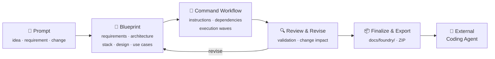

<div align="center">

**English** | [Bahasa Indonesia](README.id.md)

# ⚒️ Foundry

### Universal Software Blueprint & Command Workflow Designer

**Turn ideas into structured blueprints and command workflows ready for your coding agent.**

[](https://github.com/handrawanwdev/Foundry/actions/workflows/ci.yml)
[](https://github.com/handrawanwdev/Foundry/releases)
[](https://go.dev)
[](https://react.dev)
[](https://www.typescriptlang.org)
[](https://modelcontextprotocol.io)
[](#-project-status)
[](LICENSE)

[Why Foundry](#-why-foundry) •
[How It Works](#-how-it-works) •
[Features](#-key-features) •
[Quick Start](#-quick-start) •
[MCP](#-coding-agent-integration-mcp) •
[Development](#-development) •
[License](#-license)

</div>

---

> **Foundry is not a coding agent and not an IDE.**
> Foundry is the **planning and specification layer** between an idea and its implementation — requirements, architecture, technology, UI design, use cases, acceptance criteria, and implementation instructions are assembled into one connected specification that can be reviewed and exported.

## 💡 Why Foundry?

Prompting an AI and asking it to write code straight away is rarely enough. Without structured planning, you often end up with:

| Problem                                          | Foundry's answer                                                    |
| ------------------------------------------------ | ------------------------------------------------------------------- |
| Ambiguous or conflicting requirements            | Discovery, a technical survey, and an explicit **decision register** |
| Architecture & stack that don't fit the need     | Profile-based stack recommendations that require your approval      |
| Implementation instructions that lose context    | Every command references blueprint artifacts directly               |
| Spec changes with undetected impact              | **Artifact hashes** flag affected commands & artifacts `needs_review` |
| Features "done" but not meeting criteria         | **Traceability** from requirement → acceptance criteria → command   |
| Work that is hard for another agent to pick up   | A portable export package in `docs/foundry/`                        |

In short: Foundry **separates designing software from implementing it**.

## 🔄 How It Works



Foundry prepares the instructions and the specification. **The developer stays in control** of decisions, reviews, and approval before the specification is finalized.

## ✨ Key Features

<table>
<tr>
<td width="50%" valign="top">

### 📐 Adaptive blueprint
The single source of truth for the project's design. Artifacts adapt to the kind of software — firmware isn't forced to have a UI design, while products with screens must have valid design rules and layouts.

</td>
<td width="50%" valign="top">

### 🧩 Validated command workflow
Work instructions for the coding agent, with dependencies, artifact references, and acceptance criteria. Dependencies are validated to be cycle-free; independent commands are grouped into **parallel waves**.

</td>
</tr>
<tr>
<td valign="top">

### 🔗 End-to-end traceability
Requirement → Feature → Use Case → Acceptance Criteria → Command. Every piece of work can be traced back to why it exists.

</td>
<td valign="top">

### 🛡️ Change impact detection
Artifact hashes detect specification changes; affected commands and artifacts are automatically flagged for re-review.

</td>
</tr>
<tr>
<td valign="top">

### 🏗️ Existing-project aware
Scans existing code: structure, stack, routes, layout shell, shared components, and design tokens are kept as the baseline — never silently replaced.

</td>
<td valign="top">

### 🔌 Agent-agnostic
Works with Claude Code, Codex, OpenCode, Qwen Code, Gemini, and other MCP hosts. Not locked into a single AI provider.

</td>
</tr>
</table>

### Blueprint artifacts

| Artifact                      | Contents                                                                         |
| ----------------------------- | -------------------------------------------------------------------------------- |
| **Requirements**              | System requirements and constraints                                              |
| **Architecture**              | Architecture and division of responsibilities                                    |
| **Technology**                | Technology choices and their rationale                                           |
| **Design Rules**              | UI principles, design tokens, components, accessibility, UX rules *(if there's a UI)* |
| **Layout Specification**      | Shells, pages, routes, sections, navigation, UI states *(if there's a UI)*       |
| **Use Cases**                 | Actors, flows, business rules, failure conditions                                |
| **Acceptance Criteria**       | Conditions a feature must meet                                                   |
| **Decisions**                 | Assumptions, open questions, conflicts, risks, and their resolutions             |
| **Project-specific**          | API contracts, domain models, protocols, threat models, test strategy, etc.      |

### Example command workflow

```text
Wave 1   CMD-001  Define Domain Model
Wave 2   CMD-002  Implement Persistence
Wave 3   CMD-003  Implement Business Use Cases
Wave 4   CMD-004  Implement API        CMD-005  Implement UI Shell   ← parallel
Wave 5   CMD-006  Verify Acceptance Criteria
```

Each command contains: objective & context, reference artifacts, instructions, dependencies, covered requirements, constraints, expected outputs, and acceptance criteria.

### Export package

Once validated and finalized, Foundry produces a documentation package in `docs/foundry/` (also downloadable as a ZIP):

```text
docs/foundry/
├── README.md
├── manifest.json
├── spec.json
├── traceability.md
├── blueprint/      requirements.md · architecture.md · threat-model.md · …
├── workflow/       CMD-001.md · CMD-002.md · workflow.json
├── design/         design-rules.json · layout-spec.json
└── adr/            0001-stack.md · …
```

> The structure above is illustrative — generated files match the artifacts that apply to the project.

## 🌐 Supported Platforms

| Platform    | Examples                                                |
| ----------- | ------------------------------------------------------- |
| 🌍 Web      | Dashboards, SaaS, business apps, admin consoles         |
| 📱 Android  | Native or cross-platform                                |
| 🍎 iOS      | iPhone & iPad                                           |
| 🖥️ Desktop  | Linux, Windows, macOS                                   |
| ⚙️ Backend  | APIs, business services, transaction systems            |
| ⌨️ CLI      | Developer tools, automation                             |
| 🔧 Embedded | Firmware, IoT, robotics                                 |
| 📚 Other    | Libraries, SDKs, data pipelines, ML, infrastructure, tooling |

A single project can span multiple platforms. Foundry **doesn't impose a specific stack** — recommendations consider the requirements, existing code, developer preferences, and the project profile (`saas`, `enterprise`, `mobile-app`, `ai-product`, `trading`). Optional components such as caching, messaging, workers, and search are only recommended when actually needed.

## 🚀 Quick Start

### Download a release

Grab the archive for your OS from [Releases](https://github.com/handrawanwdev/Foundry/releases) (Linux, macOS, Windows — amd64 & arm64), extract it, and run:

```bash
foundry serve
```

The UI is embedded in the binary; you only need an AI CLI installed (`claude`, `codex`, `opencode`, `qwen`, or `gemini`).

### Build from source

Prerequisites:

- **Go** 1.22+
- **Node.js** 20.19+ or 22.12+ (to build the UI)
- **make**
- At least one AI CLI installed: `claude`, `codex`, `opencode`, `qwen`, or `gemini`

```bash
git clone https://github.com/handrawanwdev/Foundry.git
cd Foundry

make build                      # build UI + binary → bin/foundry
./bin/foundry serve             # open http://127.0.0.1:8080
```

Or open a specific project folder directly:

```bash
./bin/foundry serve ~/work/clinic
./bin/foundry serve --addr 127.0.0.1:9000 ~/work/clinic
```

Install to `$GOBIN` to run it from any folder:

```bash
make install
foundry serve
```

### UI flow

**Connect AI → Prompt → Design (preview + revise) → Finalize**

Without a folder argument, the UI opens on the **Start** page to Open / New / Close a project. Planning state is stored in `.foundry/` inside the project folder.

> The UI and CLI messages are currently in Bahasa Indonesia.

## 🤖 Coding Agent Integration (MCP)

Foundry ships a **Model Context Protocol** server (JSON-RPC 2.0 over stdio) backed by the same service as the UI. MCP hosts such as Claude, Codex, OpenCode, Cursor, or Windsurf can read project context and submit design work back to Foundry.

Print the host configuration:

```bash
foundry mcp --print-config --project ~/work/clinic
```

```json
{
  "mcpServers": {
    "foundry": {
      "command": "/path/to/foundry",
      "args": ["mcp", "--allow", "READ,WRITE,MODIFY", "--project", "/home/me/work/clinic"]
    }
  }
}
```

### Tools

| Tool               | Permission | Purpose                                                                     |
| ------------------ | ---------- | --------------------------------------------------------------------------- |
| `get_project`      | `READ`     | Project summary: stage, discovery, architecture, platform, stack, job       |
| `get_requirements` | `READ`     | Requirements, acceptance criteria, features, use cases, Definition of Done  |
| `get_blueprint`    | `READ`     | All blueprint artifacts (Markdown), artifact states, decision register      |
| `get_workflow`     | `READ`     | Commands, dependencies, execution waves, validation issues, `needs_review` commands |
| `get_design`       | `READ`     | Structured design rules & layout spec with validation issues                |
| `get_spec`         | `READ`     | Full specification (JSON + Markdown) for implementation outside Foundry     |
| `next_work`        | `MODIFY`   | Fetch the next piece of design work Foundry needs                           |
| `submit_work`      | `WRITE`    | Hand back a result; Foundry validates it                                    |

Permissions are set with `--allow` (default: `READ`). The printed config grants `READ,WRITE,MODIFY`, which is what `next_work` and `submit_work` need; use `--allow READ` for read-only hosts.

## 🚫 What Foundry Does Not Do

These boundaries are intentional. Foundry does **not**:

- write application code as an implementation output;
- run application builds, tests, or deployments;
- execute the command workflow or run coding agents to implement it;
- scaffold application code or folder structures;
- replace your IDE, repository, Figma, or implementation tools.

Foundry only writes its planning state to `.foundry/` and the documentation package on finalization.

## 🧭 Design Principles

1. **Requirements before implementation** — requirements first, instructions second.
2. **Blueprint as source of truth** — connected artifacts are the reference.
3. **Project-adaptive** — the design fits the kind of software.
4. **Existing-project aware** — existing projects aren't forced into a new template.
5. **Explicit decisions** — assumptions, conflicts, and risks must be visible.
6. **Validated dependencies** — workflows are valid and cycle-free.
7. **Traceable requirements** — requirements trace to criteria and commands.
8. **Human approval** — key decisions and finalization belong to the developer.
9. **Portable output** — results can be exported and used outside Foundry.
10. **Implementation agnostic** — Foundry designs; the coding agent implements.

## 🛠️ Development

```bash
make dev-api     # API on :8080
make dev-web     # Vite on :5173 (proxies /api to :8080)

make test        # go vet + go test + typecheck + vitest
make check       # test + build
make clean
```

### Repository layout

```text
cmd/foundry/          CLI entry point (serve · mcp · version)
apps/web/             UI — React 19 + TypeScript + Vite, embedded into the binary
internal/
├── core/             Project model, store, blueprint, workflow, survey
├── modules/
│   ├── pipeline/     Stage orchestration (TELL → DISCOVERY → DESIGN → READY), shared by UI & MCP
│   ├── work/         Builds each kind of design work for the AI
│   ├── agent/        AI CLI adapters (Claude Code, Codex, OpenCode, Qwen Code, Gemini)
│   ├── spec/         Final specification & export package
│   ├── workflow/     Command workflow validation
│   ├── stack/        Stack recommendations & project profiles
│   ├── structure/    Repository structure decisions
│   ├── scan/ uiscan/ Existing project & UI scanning
│   └── standard/     Design principles & instructions for the coding agent
├── transport/
│   ├── httpapi/      HTTP API for the UI
│   └── mcp/          MCP server (stdio)
├── config/           Global config ($FOUNDRY_HOME or ~/.foundry/foundry.json)
├── proc/             Child process management (nothing outlives Foundry)
└── safefile/         Atomic file operations & locking
```

## 📍 Project Status

Foundry is in **early development**. APIs, export format, and workflows may change between versions. The agents listed above are integration targets — not every integration path has been tested with every agent.

Feedback, bug reports, and pull requests are welcome via [GitHub Issues](https://github.com/handrawanwdev/Foundry/issues).

## 📄 License

Released under the [MIT License](LICENSE) © 2026 handrawanw.

---

<div align="center">

**Foundry — From software ideas to structured blueprints and actionable command workflows.**

*Turn ideas into specifications. Turn specifications into workflows. Let your coding agent implement.*

</div>
